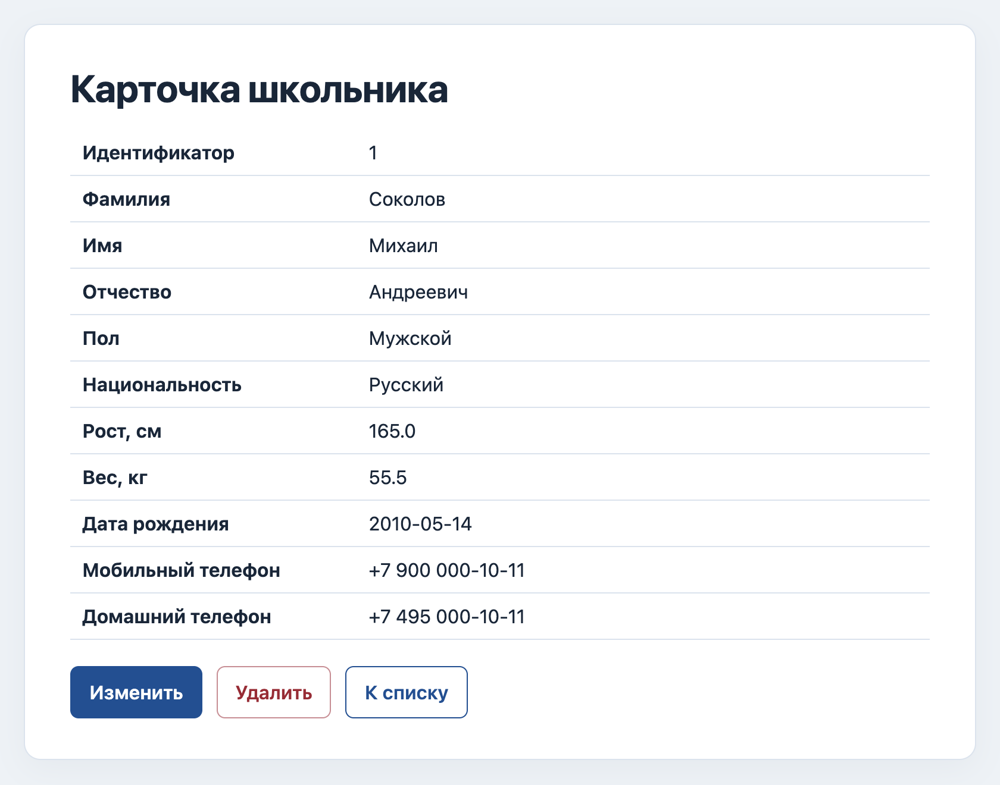
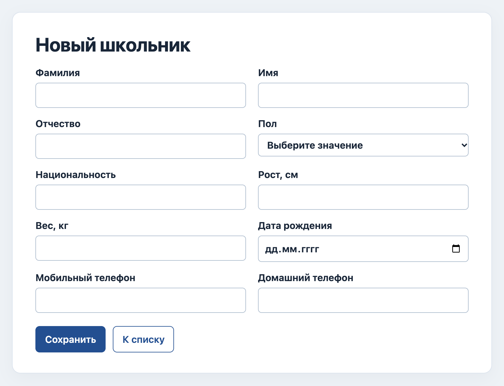
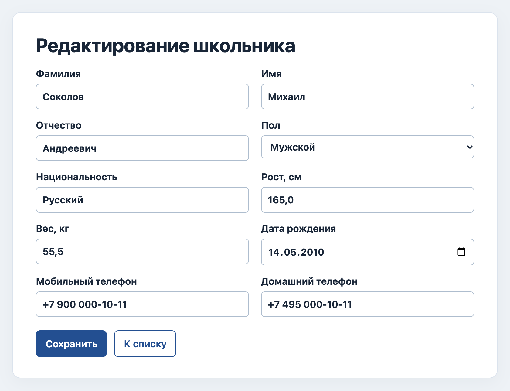

# Лабораторная работа № 2. Spring Data JPA

## Цель работы

Реализовать управление данными школьников по варианту 2 и показать отдельный пример сущности студента из методических указаний.

## Архитектура проекта

Стек включает Java 17, Spring Boot 3.5.16, Maven Wrapper и Spring MVC, Thymeleaf, Spring Data JPA, H2, Jakarta Validation.

- `Schoolboy` хранит фамилию, имя, отчество, пол, национальность, рост, вес, дату рождения, мобильный и домашний телефоны.
- `Student` хранит ФИО, город, пол, возраст, группу и факультет.
- Репозитории Spring Data выполняют запросы к H2. Контроллеры обрабатывают запросы и возвращают шаблоны Thymeleaf.
- Аннотации `@Entity`, `@Id`, `@GeneratedValue`, `@Controller`, `@ModelAttribute`, `@Valid`.

## Алгоритм работы

1. Откройте список школьников. При запуске Hibernate создаёт таблицы, а `data.sql` заполняет их примерами.
2. Добавьте запись, откройте карточку, измените данные и удалите запись из карточки. Рост указывается в сантиметрах, вес в килограммах.
3. Просмотр, изменение и удаление проверяют наличие записи. Для отсутствующего идентификатора возвращается HTTP 404.
4. По ссылке «Пример «Студенты»» откройте второй раздел. Он показывает расширенные поля студента и позволяет добавить запись.

## Запуск в IntelliJ IDEA

1. Откройте папку с файлом `pom.xml` в IntelliJ IDEA и дождитесь импорта Maven.
2. В **File → Project Structure → Project SDK** выберите JDK 17, если среда ещё не выбрала его.
3. Выберите конфигурацию **Лабораторная 2** и нажмите **Run**. Откройте [страницу приложения](http://127.0.0.1:8082/schoolboys/main).

Данные H2 находятся в памяти. После перезапуска восстанавливаются демонстрационные записи.

Готовый исходный проект также доступен в [архиве](lab2.zip).

Для проверки проекта из терминала выполните `./mvnw clean verify`.

## Скриншоты работы приложения

**Список школьников**

**Карточка школьника**

**Форма добавления**

**Форма редактирования**

**Пример со студентами**

