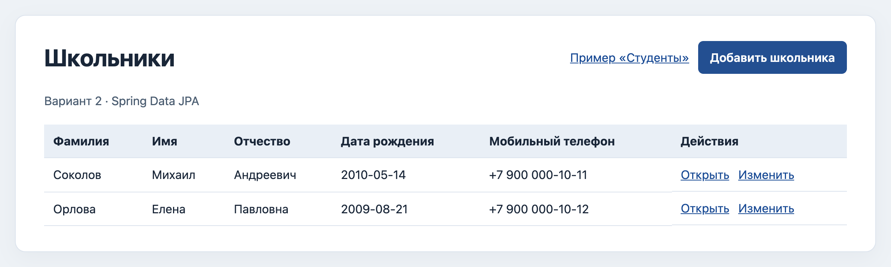
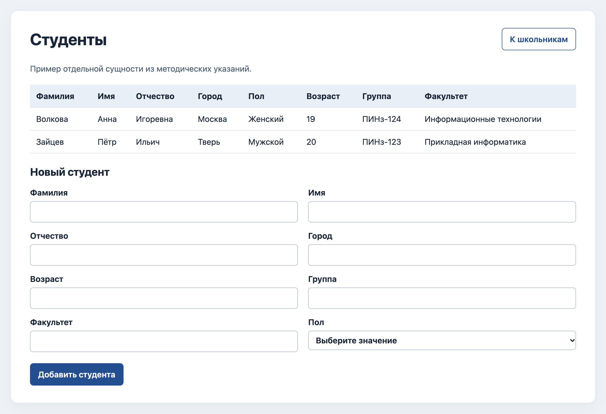

# Лабораторная работа № 2. Spring Data JPA

## Цель работы

Реализовать операции создания, чтения, изменения и удаления школьников по варианту 2 с помощью Spring Data JPA. В отдельном разделе показать пример работы с сущностью студента.

## Архитектура проекта

- **Стек:** Java 17, Spring Boot 3.5.16, Maven Wrapper, Spring MVC, Thymeleaf, Spring Data JPA, Jakarta Validation.
- **СУБД:** H2 в памяти. При перезапуске восстанавливаются демонстрационные данные.
- **Основные слои:**
  - **Controller** — `SchoolboyController` обрабатывает запросы по `/schoolboys`, а `StudentController` отвечает за раздел `/students`.
  - **Repository** — `SchoolboyRepository` и `StudentRepository` предоставляют операции чтения и сохранения сущностей в H2.
  - **View** — шаблоны Thymeleaf отображают список, карточку и формы.
- **Ключевые аннотации:** `@Entity`, `@Id`, `@GeneratedValue`, `@Controller`, `@ModelAttribute`, `@Valid`.

## Алгоритм работы

1. При запуске Hibernate создаёт таблицы, а `data.sql` загружает демонстрационные записи.
2. Открыть `/schoolboys/main` и перейти из списка к отдельной карточке. Новую или изменённую запись сохранить через `POST /schoolboys/save`.
3. Удалить запись из карточки. Перед просмотром, изменением и удалением сервер проверяет, существует ли запись. Для отсутствующего ID он возвращает HTTP 404.
4. Открыть `/students`, чтобы просмотреть и добавить запись в отдельном примере со студентами.

## Скриншоты работы приложения

**Список школьников**

**Карточка школьника**

**Форма добавления**

**Форма редактирования**

**Пример со студентами**

